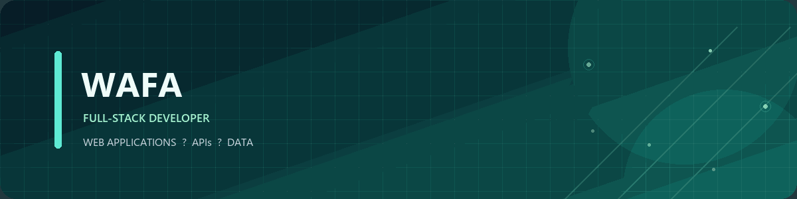

  
  <h1>Halo, saya Wafa 👋</h1>
  
<strong>Full-stack developer yang membangun aplikasi web dan solusi berbasis data.</strong>

  

    <a href="https://github.com/wafa-coder">GitHub</a>
    &nbsp;·&nbsp;
    <a href="https://github.com/wafa-coder?tab=repositories">Proyek</a>
  

---

## Tentang saya

Saya menikmati proses membangun produk digital dari awal hingga siap digunakan:
mulai dari dashboard bisnis dan aplikasi web hingga eksperimen machine learning.

- Mengembangkan aplikasi full-stack dengan fokus pada pengalaman pengguna
- Merancang API dan alur kerja yang menghubungkan beberapa layanan
- Mengeksplorasi machine learning untuk analisis dan klasifikasi data

## Proyek pilihan

| Proyek | Ringkasan | Teknologi |
| --- | --- | --- |
| [Botika — Manajemen Inventaris](https://github.com/wafa-coder/Botika-inventaris) | Dashboard inventaris dengan autentikasi, analitik, dan API | Laravel · Nuxt · MySQL |
| [Sentul Laundry](https://github.com/wafa-coder/sentul-laundry) | Aplikasi web untuk pengelolaan pesanan dan operasional laundry | Next.js · TypeScript · Prisma |
| [Analisis Aroma Kopi](https://github.com/wafa-coder/Analisis-Pola-Aroma-10-Jenis-Kopi-Menggunakan-Deep-Learning-ANN-Keras-TensorFlow-) | Eksperimen klasifikasi 10 jenis kopi menggunakan data sensor aroma | Python · TensorFlow · Keras |

### Kolaborasi terbaru

[Portal Kemenag Wonosobo](https://github.com/XiaoSan098/web-kemenag-wonosobo) —
portal informasi layanan publik dengan panel admin. React · Vite · Express · MySQL.

## Teknologi

  
  
  
  
  
  
  
  
  

---

  Merancang solusi yang berguna, satu fitur dalam satu waktu.

